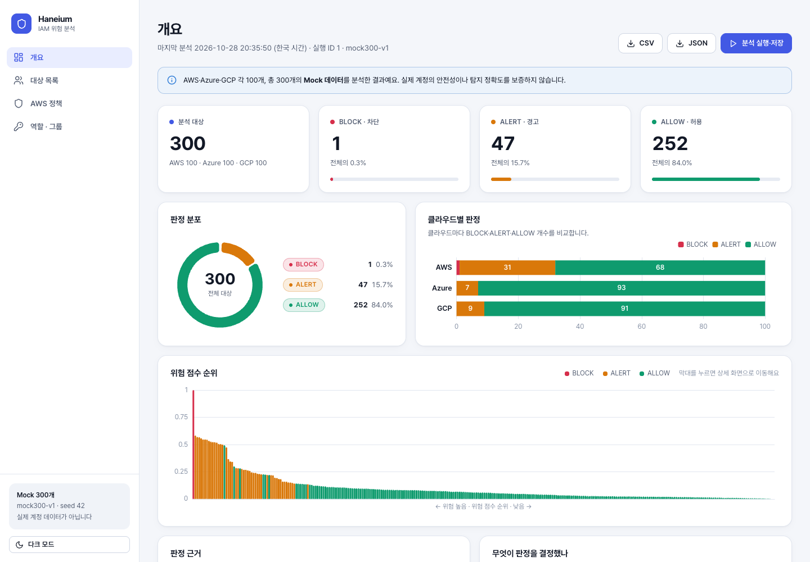
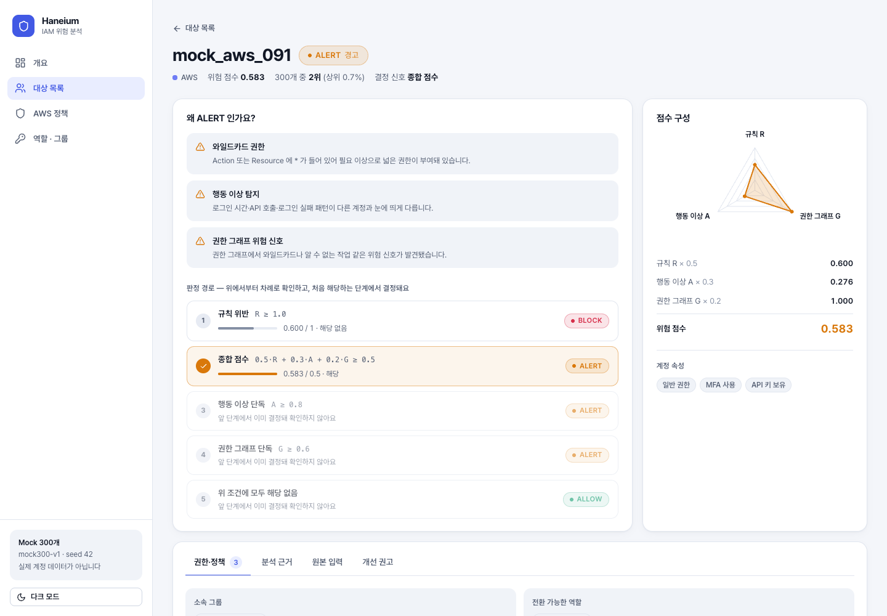
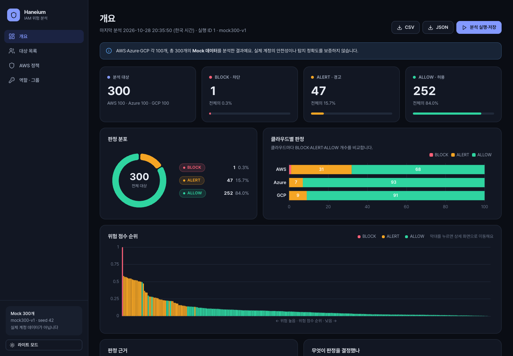

# Haneium — 멀티클라우드 IAM 위험 분석

AWS·Azure·GCP의 IAM 정책, 보안 설정, 행동 데이터를 **규칙 · 행동 이상 탐지(AI) · 권한 그래프** 세 가지로 분석해
대상마다 `ALLOW / ALERT / BLOCK` 판정과 개선 권고를 내는 한이음 프로젝트입니다.



<table>
  <tr>
    <td></td>
    <td></td>
  </tr>
</table>

> **데이터 안내** — 분석 대상 300개는 **Mock 데이터**입니다(AWS·Azure·GCP 각 100개, 시드 42, 논문의 기존 25개 포함).
> 실제 운영 계정의 데이터가 아니며, 결과가 실제 계정의 안전성이나 탐지 정확도를 보증하지 않습니다.

## 구성

| 폴더 | 내용 |
|---|---|
| [`haneium-project/`](haneium-project) | 분석 엔진 — 정책 정규화, 규칙, 행동 이상 탐지, 권한 그래프, 통합 판정, 개선 시뮬레이션, 데이터·검증 코드 |
| [`haneium-web/`](haneium-web) | 대시보드 — FastAPI(백엔드) + Vue 3(프론트). 자세한 내용은 [haneium-web/README.md](haneium-web/README.md) |

## 빠른 시작

필요한 것: **Python 3.12 이상**(고정 버전 numpy 2.5.4 때문), **Node.js 20.19 이상**

```bash
cd haneium-web
./setup.sh     # 가상환경(.venv)과 패키지 설치 — 처음 한 번
./dev.sh       # API(8010) + 화면(5173) 실행
```

브라우저에서 **http://localhost:5173** 을 엽니다. 저장소를 처음 받은 상태라면 첫 접속 때 분석이 한 번 자동으로 실행돼요(몇 초 걸립니다).
화면 위쪽의 **분석 실행·저장**을 누르면 다시 분석하고 `haneium-project/data/iam.db`에 이력을 저장합니다.

## 분석 방식

대상마다 세 점수(0~1)를 구해 합칩니다.

| 점수 | 내용 |
|---|---|
| 규칙 R | 발동한 규칙의 심각도 합(최대 1.0) — `NO_ROOT_KEY` 1.0, `NO_WILDCARD` 0.6, `MFA_REQUIRED` 0.5, `API_KEY_NO_MFA` 0.4 |
| 행동 이상 A | Isolation Forest로 로그인 시간·API 호출·로그인 실패 패턴이 얼마나 이상한지 |
| 권한 그래프 G | 와일드카드, 분류되지 않은 작업, 권한 상승 가능 작업 등 정책 구조의 위험 신호 |

판정은 위에서부터 차례로 확인하고, 처음 해당하는 단계에서 결정됩니다.

1. `R ≥ 1.0` → **BLOCK**
2. `0.5·R + 0.3·A + 0.2·G ≥ 0.5` → **ALERT**
3. `A ≥ 0.8` → **ALERT** (행동 이상 단독)
4. `G ≥ 0.6` → **ALERT** (권한 그래프 단독)
5. 그 외 → **ALLOW**

현재 Mock 300개의 결과는 BLOCK 1 · ALERT 47 · ALLOW 252입니다. 대상 상세 화면에서 각 대상이 어느 단계에서 결정됐는지 볼 수 있어요.

## 테스트

```bash
cd haneium-project
../haneium-web/.venv/bin/python -m unittest \
  checks.check_aws_role_policies checks.check_aws_group_policies checks.check_policy_validation
```

60개 중 59개가 통과하고 1개는 건너뜁니다. 건너뛰는 테스트는 실제 AWS 수집본(`data/aws_iam_snapshot.json`)이 있을 때만 실행돼요.

## 커밋하면 안 되는 것

- **`haneium-project/data/aws_iam_snapshot.json`** — 실제 AWS 계정에서 수집한 원본입니다(계정 ID 포함). `.gitignore`에 등록돼 있지만, 직접 만들었다면 올라가지 않았는지 확인하세요.
- AWS 자격 증명(액세스 키 등) — `data/aws_collector.py`로 실제 수집할 때만 필요하며 코드나 문서에 적지 마세요.
- `data/iam.db`, `validation/reports/` 안의 결과 파일 — 실행하면 생기는 파일이라 `.gitignore`로 제외했습니다.

## 더 읽을 것

- [`haneium-project/MOCK300_GUIDE.md`](haneium-project/MOCK300_GUIDE.md) — 300개 Mock 구성
- [`haneium-project/EXTENDED25_GUIDE.md`](haneium-project/EXTENDED25_GUIDE.md) — 기존 25개에 역할·그룹을 더한 단계
- [`haneium-project/POLICY_VALIDATION_GUIDE.md`](haneium-project/POLICY_VALIDATION_GUIDE.md) — 정책 사례 검증
- [`haneium-project/LOCAL_CHANGES.md`](haneium-project/LOCAL_CHANGES.md), [`haneium-project/README`](haneium-project/README) — 개발 기록.
  이 기록에는 이전의 Streamlit 대시보드 설명이 남아 있어요. Streamlit 화면은 Vue 화면으로 대체되어 이 저장소에 포함하지 않았습니다.
- [`haneium-project/notebooks/haneium_original.ipynb`](haneium-project/notebooks/haneium_original.ipynb) — 원본 Colab 코드
